  

  
  
  

  

<h2 align="center">Hello, I'm Kavidu</h2>

IT undergraduate at <strong>BCI</strong> · Sri Lanka I build practical web and mobile applications and enjoy learning how thoughtful software can improve everyday workflows.

## About me

- Currently exploring the Laravel ecosystem and modern DevOps practices.
- I enjoy working across backend services, web interfaces, and mobile app development.
- My recent projects include a GPS bus-tracking API, a WhatsApp support dashboard, a Flutter task manager, and a React portfolio.
- [Explore my portfolio](https://kavidu-himansa-portfolio.vercel.app) or connect with me on [LinkedIn](https://www.linkedin.com/in/kavidu-himansa-0bb6802a6).

## Technologies

  

## Featured projects

<table>
  <tr>
    <td width="50%" valign="top">
      <h3><a href="https://github.com/kaviduhimansa/Bus-Tracking-System">GPS Bus Tracking API</a></h3>
      
A Laravel backend for managing buses, drivers, routes, and schedules, with GPS location endpoints, role-based access, and overspeed alerts.

      Laravel 12 · PHP · MySQL · Laravel Sanctum
    </td>
    <td width="50%" valign="top">
      <h3><a href="https://github.com/kaviduhimansa/whatsapp-chatbot-project">SLT WhatsApp Support Dashboard</a></h3>
      
An internal support workspace for syncing recent contacts, viewing conversations, replying through the SLT API, and coordinating agents with chat locks.

      Laravel 12 · PHP · MySQL · Blade · Alpine.js · Tailwind CSS
    </td>
  </tr>
  <tr>
    <td width="50%" valign="top">
      <h3><a href="https://github.com/kaviduhimansa/student_task_manager">Student Task Manager</a></h3>
      
A Flutter app for organizing student tasks by category and priority, tracking pending or completed work, and deleting tasks.

      Flutter · Dart
    </td>
    <td width="50%" valign="top">
      <h3><a href="https://github.com/kaviduhimansa/kavidu-himansa-portfolio">Personal Portfolio</a></h3>
      
A React portfolio presenting profile information, skills, projects, achievements, and contact details.

      React · JavaScript · Vite
    </td>
  </tr>
</table>

### WhatsApp dashboard preview

  
  

## GitHub activity

  
  

  

## Contributions in motion

  

## Let's connect

I'm always glad to meet people who enjoy building useful software. Visit my [portfolio](https://kavidu-himansa-portfolio.vercel.app), find me on [LinkedIn](https://www.linkedin.com/in/kavidu-himansa-0bb6802a6), or [send me an email](mailto:kawwahimansa@gmail.com).

Thanks for stopping by — happy building!

